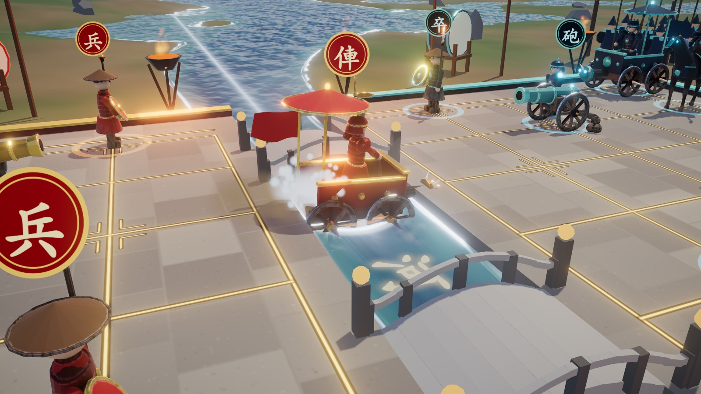

<p align="center">
  
</p>

<h1 align="center">楚漢爭鋒 · Chu–Han Contention</h1>

<p align="center">
  Xiangqi (Chinese chess) staged as a battle.<br>
  Real troops, a real river, and a cinematic for every capture.
</p>

<p align="center">
  <b><a href="https://nervouna.github.io/fable-chess/">▶ Play it in your browser</a></b>
</p>

<p align="center">
  
  
  
  
</p>

## What it is

A complete xiangqi game that runs in the browser with no server. Play a friend on one machine or over
a link, play the computer, or sit back and watch the computer fight itself while a director moves the
camera.

It was built as a showpiece: the world, the effects, the sound and the music are generated in code, and
the seven unit models are generated by a Blender script that ships in this repository.

<table>
  <tr>
    <td width="50%"></td>
    <td width="50%"></td>
  </tr>
  <tr>
    <td width="50%"></td>
    <td width="50%"></td>
  </tr>
  <tr>
    <td colspan="2"></td>
  </tr>
</table>

## Highlights

### The battle

- **Seven troop types.** General, guard, war elephant, cavalry, war wagon, cannon and infantry, each
  with its own way of moving, bracing, attacking and dying.
- **Duels.** Every attacker has three techniques, chosen by whether it is fighting foot soldiers,
  beasts or machines (21 in total). Each of the 36 attacker and victim pairings has its own title card.
- **Capture cinematics.** Letterbox, a close-up camera that follows the victim, hit-stop, a
  bullet-time orbit, an impact frame with speed lines, screen shake and tilt-shift blur.
- **A battlefield that remembers.** Craters, soot, cracks, hoof prints and wheel ruts accumulate.
  Wreckage stays where it lands, blast sites smoulder, and the armies get dustier as the game goes
  on. Undo rolls all of it back.
- **A river you can wade.** 楚河漢界 is real water: it flows, darkens in the deep channel, foams at
  the banks, glitters at noon and turns choppy in a storm. Troops crossing off the bridges wade in,
  slowed and splashing.
- **Armies that watch.** Behind each back rank wait the reserves: spearmen, war drums and great
  banners. They cheer a capture, drum through a check and erupt at the mate. A losing army thins
  and stoops.
- **Weather driven by the game.** Dawn mist at the opening, noon in the middlegame, a red dusk in
  the endgame. A check brings storm clouds and lightning; the end brings rain and wet stone.
- **Sound without samples.** Every effect is synthesised with WebAudio, and an adaptive score of war
  drums, plucked zither and a low ostinato layers up with the tension.

### The game

- **Full rules.** Hobbled horses, blocked elephant eyes, cannon screens, palace limits, the river,
  the flying general, no moving into check. Checkmate and stalemate both lose. Threefold repetition
  is a draw unless one side repeats only by checking (that side loses); 120 plies without a capture
  is a draw.
- **Three modes.** Two players, red against the computer, or spectate. The AI is an
  iterative-deepening alpha-beta search with a transposition table, quiescence, and killer and
  history ordering, running in a Web Worker so the picture never stalls while it thinks.
- **Openings and styles.** A small book of mainstream openings, answered instantly and announced by
  name. Each computer side plays 均衡, 猛攻 or 稳健, with its own evaluation, draw contempt and
  taste in openings.
- **Commentary.** A short line on notable moments, judged from the search: a sacrifice, a turn of
  fortune, a mate found (三步之内，胜负已分).
- **Play a friend online.** Peer to peer over WebRTC, with no game server: send an invite link,
  paste back the reply code, play. Each side checks every move the other sends against its own
  rules engine.
- **Phones too.** Touch gestures, layouts for portrait and landscape, and three quality tiers
  picked from the device.

### Replay and share

- **Records and links.** Every game is a compact record, about one character per move. Copy it as a
  link or as text; opening the link replays the game. Step, scrub, or play it back at 1×, 2× or 4×.
- **Highlight reel.** Every move is scored and the best moments are cut into a reel of about a
  minute, each with a title card and the full duel camera. Export it as an MP4 or WebM video, sound
  included.
- **Classic games, restaged.** Seven lines from the Ming and Qing manuals 橘中秘 (1632) and 梅花譜,
  among them 棄馬十三著, play themselves with each move named as it lands. Their sources are cited
  in the code.

## Run it

```bash
npm install
npm run dev      # then open the printed URL
```

```bash
npm test         # rules, records, notation, classics, reel, AI, book, online, morale
npm run build    # type-check and produce a static build in dist/
```

The tests run TypeScript directly and need Node 23 or newer.

Every push to `main` is tested, built and deployed to GitHub Pages.

## Controls

| Input | Action |
| --- | --- |
| Click a unit, then a glowing ring | Move / capture |
| Left drag / wheel / right drag | Orbit / zoom / pan |
| `R` or `Space` | Reset view |
| `Z` / `N` | Undo / new game |
| `1` / `2` / `3` | Two players / versus computer / spectate |
| 人机 / 观战 again | Change the computer's style / draw a new pairing |
| 双人 again | Choose this machine or online play (see below) |
| `C` / `G` / `M` / `B` | Toggle auto camera / unit glyph badges / sound / music |
| `H` | Toggle authored models (falls back to the original code-built ones) |
| `Q` | Cycle quality: low / mid / high (also `?q=low` in the URL) |
| `P` | Replay the game (also 复盘 in the move list or the result card) |
| `←` / `→` / `Space` / `Esc` | In replay: step back / forward, play or pause, leave |
| `L` | Highlight reel (also 集锦 on the result card or the share card); `Esc` leaves |
| `K` | Classic games (also 名局 in the move list or the replay bar) |

分享 copies a link (`#g=<record>`) or the readable record. Paste either onto the page to replay it;
a game in traditional notation (炮二平五 马8进7 …) pastes too.
导出视频 records the reel as it plays (at least 1280 pixels on the long side, at most 1080p) and
offers the file to download or, where the browser can, to share.

Quality follows the device at first, then your choice. Lower tiers use lighter models.

On a phone or tablet:

| Gesture | Action |
| --- | --- |
| Tap a unit, then a glowing ring | Move / capture |
| One-finger drag | Orbit |
| Pinch / two-finger twist | Zoom / turn the board |
| Two-finger drag up or down | Tilt |
| Double tap | Reset view |

### Playing online

Tap 双人 a second time and choose 联机对弈, pick a colour, and send the invite link
(`#join=…`, about 140 characters). Opening it shows a reply code (about 110 characters); send that
back and paste it into the host's card. The two browsers then talk directly.

In a game 悔棋 asks the opponent to take back your last move and 新局 opens the card
(求和, 悔棋, 认输); after the game 再战一局 asks for a rematch. A chip under the title shows
连接中, 已连接 with the round-trip time, or 已断开. If the connection drops, the board stays:
either player can open the card and 续弈此局 to invite the other back into the same position.
Replay, the reel and the classics are off during an online game; leave it to use them.

Limits: the peers connect directly, so each sees the other's IP address, and a public STUN
server (Google's and Cloudflare's) is asked for your public address. There is no TURN
relay, so two players behind symmetric NATs (some mobile and office networks) cannot connect.

## How it is built

| File | Purpose |
| --- | --- |
| `src/engine.ts` | Pure rules engine, no rendering dependencies |
| `src/ai.ts`, `src/ai.worker.ts` | Search engine and playing styles; its worker entry |
| `src/book.ts` | Opening book, compiled to position hashes, and opening names |
| `src/commentary.ts` | When an AI move is worth a remark, and the lines |
| `src/record.ts` | Game records: compact link form, readable text, validation |
| `src/notation.ts` | Traditional move notation (炮二平五) read back into moves |
| `src/classics.ts` | Classic games from 橘中秘 and 梅花譜, with their sources |
| `src/reel.ts` | Move scoring and clip selection for the highlight reel |
| `src/capture.ts` | Canvas and audio recording of the reel, with burned-in titles |
| `src/netgame.ts` | Online protocol: validation, resync, offers, rematch |
| `src/sdp.ts` | Invite and reply codes: SDP packed to ~110 URL-safe characters |
| `src/net.ts`, `src/online.ts` | WebRTC transport; the 联机 card and session lifecycle |
| `src/core.ts` | Game clock, tweens, easing, board ↔ world mapping |
| `src/world.ts` | Terrain, sky, board terraces, props, lighting, weather |
| `src/river.ts` | Water shader, ripple rings, wading splashes |
| `src/armies.ts`, `src/morale.ts` | Reserves, drums, banners; morale from material |
| `src/units.ts`, `src/models.ts` | Units; loader and skeleton rebuild for authored models |
| `src/choreo.ts` | Move, brace, attack and death choreography; the duel title table |
| `src/fx.ts`, `src/scars.ts` | Particles, debris, light pillars; persistent battlefield damage |
| `src/camera.ts` | Camera director: orbit, touch, cinematics, spectator mode |
| `src/audio.ts`, `src/music.ts` | Synthesised effects, rain and thunder; adaptive score |
| `src/quality.ts` | Quality tiers, first-load choice, switching |
| `src/hud.ts`, `src/style.css` | DOM overlay |
| `src/main.ts` | Renderer, post-processing, input, game flow |
| `tools/blender/build.py` | Generates the seven unit models |
| `tools/blender/lod.mjs` | Decimated `_mid` / `_lo` variants for the lower tiers |
| `tools/match.ts` | Self-play match between styles (slow, not in `npm test`) |

Post chain: MSAA → bloom → grading (tilt-shift, chromatic fringe, impact frame, desaturation,
vignette) → ACES tone mapping.

For scripted testing, `window.__game` exposes a small debug hook:

```js
__game.load(fen)                   // set up a position
__game.move('h2e2')                // resolves when the animation ends
__game.setMode('watch')            // 'pvp' | 'pve' | 'watch'
__game.style('b', 'aggressive')    // 'balanced' | 'aggressive' | 'solid'
__game.weather(time, storm, rain)  // pin the weather; no arguments releases it
__game.record()                    // compact record of the game, as in #g= links
__game.replay(text?)               // replay a record, or the current game
__game.classic(i)                  // replay a classic game
__game.reel()                      // play the highlight reel
await __game.reelExport()          // record it: { size, mime, durationMs, ... }
await __game.quality('low')        // 'low' | 'mid' | 'high'
await __game.net.host('r')         // open a room: resolves to the invite link
__game.manual = true               // stop the frame loop, then step it yourself
await __game.advance(seconds)
```

The rest of the hook (`state`, `book`, `morale`, `highlights`, `net.join`, `net.accept` and more)
is at the bottom of `src/main.ts`.

### Unit models

`tools/blender/build.py` drives Blender headless. For each unit it fuses ellipsoids into smooth bodies,
builds armour, weapons and tack, skins everything to joints that mirror the game's rig, bakes a detail
map in the rest pose (R ambient occlusion, G edge wear, B dust) and exports
`public/models/<name>.glb` with `<name>_ao.png`. Chariots and cannons are built as separable fragments,
each on its own bone, so they fly apart when destroyed.

```bash
blender -b -P tools/blender/build.py -- public/models            # all units
blender -b -P tools/blender/build.py -- public/models pawn king  # some
node tools/blender/lod.mjs public/models                         # then the lighter variants
```

The generated files are committed, so Blender is only needed to change the models. `src/models.ts`
rebuilds each skeleton with identity rest rotations, so the choreography drives the bones exactly as it
drives the code-built rigs. Budget: 6–8k triangles for foot soldiers, 10–20k for mounts and machines,
about 335k for a full board.

<table>
  <tr>
    <td width="33%"></td>
    <td width="33%"></td>
    <td width="33%"></td>
  </tr>
</table>

## Limits

- The full tournament chase rules are not implemented; only perpetual check is penalised.
- Against the computer you always play red. The AI has only been tested against itself.
- Spectator games are capped at 220 plies so two evenly matched engines cannot shuffle forever.
- Online play has no relay server: symmetric NATs on both sides cannot connect.
- Online play has been tested in Chromium only, between two tabs on one machine.
- Video export has been tested in Chromium only.
- Touch controls and the lower quality tiers have not been run on a real phone.

## License

[MIT](LICENSE)
