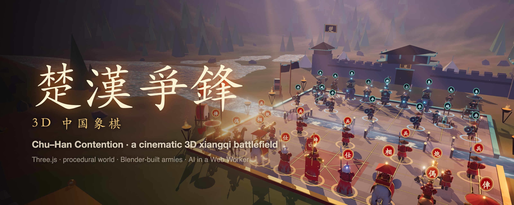
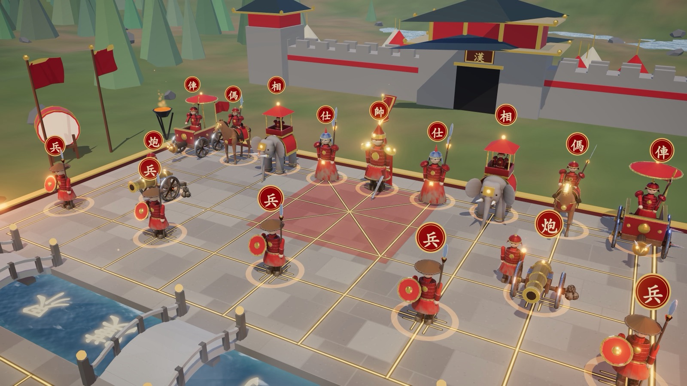
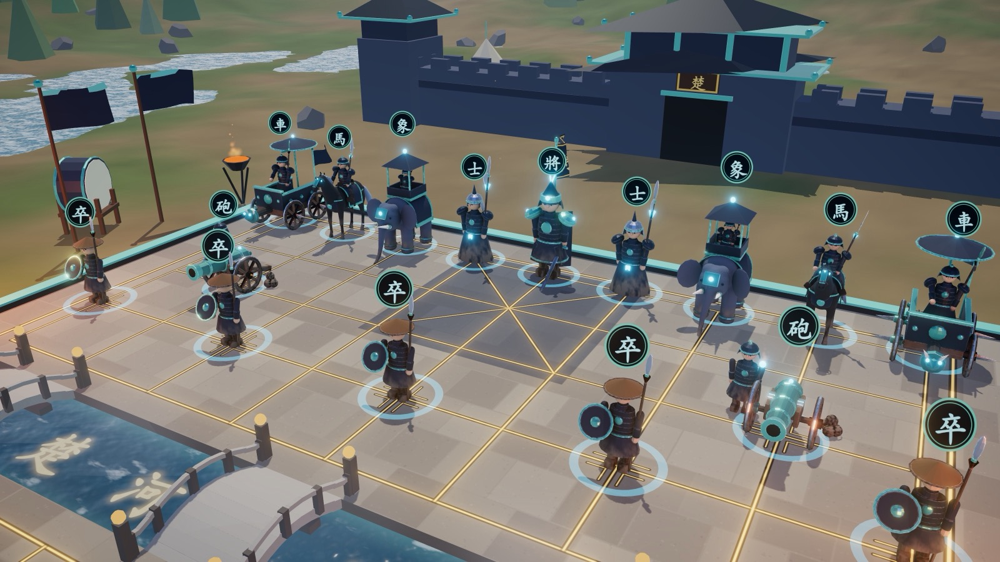
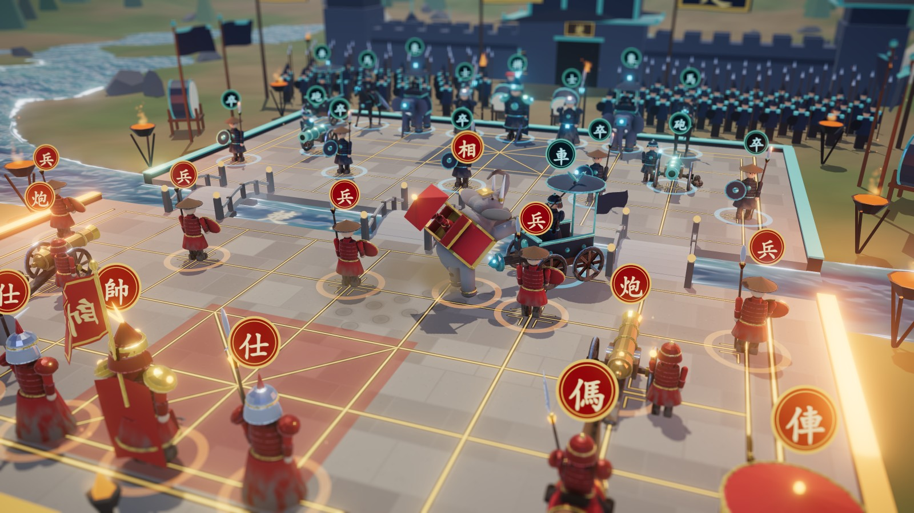
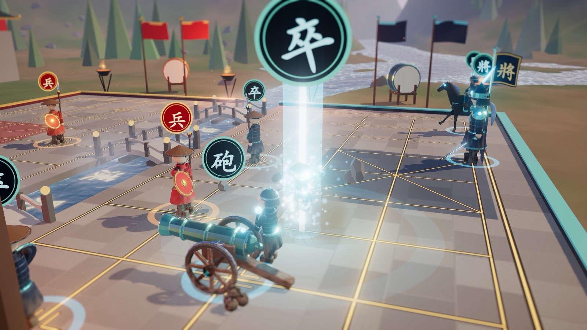
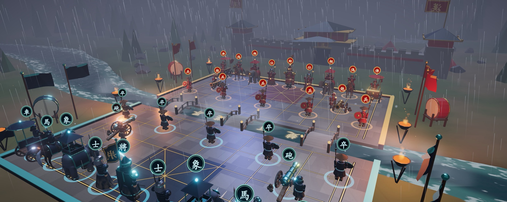
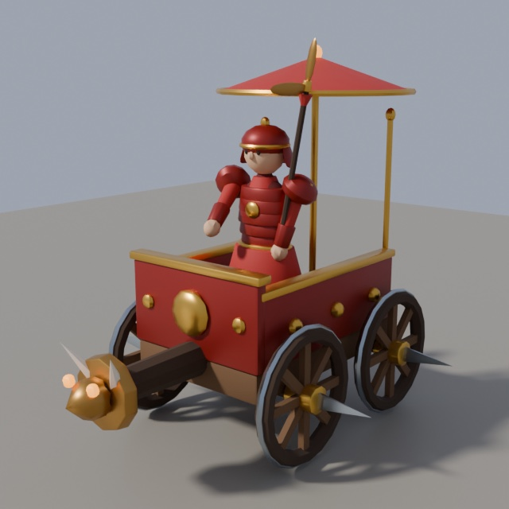
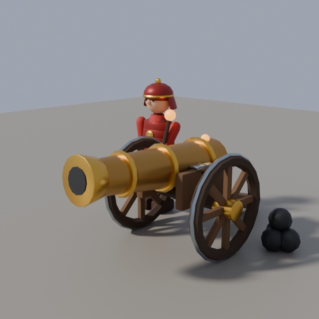
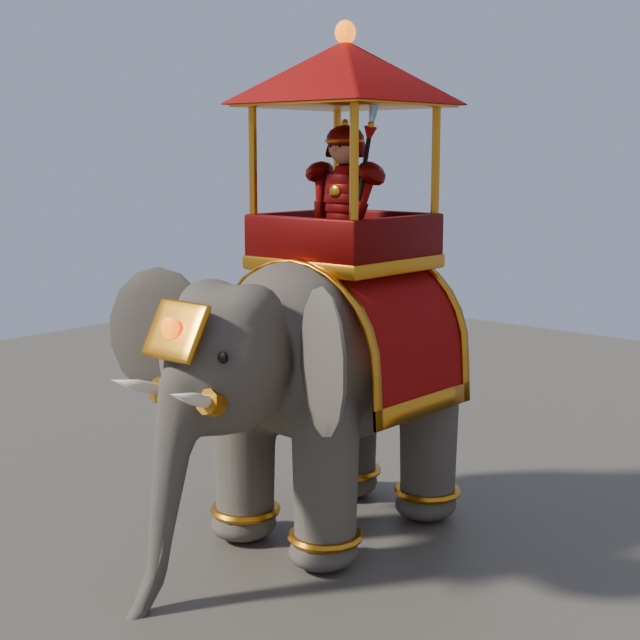

<p align="center">
  
</p>

<h1 align="center">楚漢爭鋒 · Chu–Han Contention</h1>

<p align="center">
  Xiangqi (Chinese chess) staged as a battle.<br>
  Real troops, a real river, and a cinematic for every capture.
</p>

<p align="center">
  <b><a href="https://nervouna.github.io/fable-chess/">▶ Play it in your browser</a></b>
</p>

<p align="center">
  
  
  
  
</p>

## What it is

A complete xiangqi game that runs in the browser with no server. Play a friend on one machine, play
the computer, or sit back and watch the computer fight itself while a director moves the camera.

It was built as a showpiece: the world, the effects, the sound and the music are generated in code, and
the seven unit models are generated by a Blender script that ships in this repository.

<table>
  <tr>
    <td width="50%"></td>
    <td width="50%"></td>
  </tr>
  <tr>
    <td width="50%"></td>
    <td width="50%"></td>
  </tr>
  <tr>
    <td colspan="2"></td>
  </tr>
</table>

## Highlights

- **Full rules.** Hobbled horses, blocked elephant eyes, cannon screens, palace limits, the river, the
  flying general, no moving into check. Checkmate and stalemate both lose. Threefold repetition is a
  draw unless one side repeats only by checking (that side loses); 120 plies without a capture is a
  draw. Undo, restart, a move list in traditional notation and captured-piece trays.
- **Three modes.** Two players, red against the computer, or spectate. The AI is an iterative-deepening
  alpha-beta search with a transposition table, quiescence, killer and history ordering, running in a
  Web Worker so the picture never stalls while it thinks.
- **Openings and styles.** A small book of mainstream openings (中炮 against 屏风马, 顺炮, 列炮 and
  反宫马; 飞相局, 仙人指路, 起马局, 过宫炮), mirrored, answered instantly and announced by name.
  Each computer side plays 均衡, 猛攻 or 稳健: its own evaluation terms, draw contempt and taste in
  openings. Spectator games pair two styles at random.
- **Commentary.** A short line on notable moments, judged from the search: a sacrifice it likes,
  a turn of fortune, a clear edge, a level trade, a mate found (三步之内，胜负已分).
- **Seven troop types.** General, guard, war elephant, cavalry, war wagon, cannon and infantry, each
  with its own way of moving, bracing, attacking and dying.
- **Duels.** Every attacker has three techniques, chosen by whether it is fighting foot soldiers, beasts
  or machines (21 in total). Each of the 36 legal attacker/victim pairings has its own title card.
- **Capture cinematics.** Letterbox, close-up camera that follows the victim, hit-stop, bullet-time
  orbit, an impact frame with speed lines, screen shake and tilt-shift blur.
- **A battlefield that remembers.** Craters, soot, cracks, hoof prints and wheel ruts accumulate;
  wreckage stays where it lands, weapons stick in the ground, blast sites smoulder, and the armies get
  dustier as the game goes on. Undo rolls all of it back.
- **Weather driven by the game.** Dawn mist at the opening, noon in the middlegame, a red dusk in the
  endgame. A check brings storm clouds and lightning; the end of the game brings rain and wet stone.
- **Replay and share.** Every game is a compact record (about one character per move). Copy it as
  a link or as text; opening the link replays the game. Step, scrub, or play it back at 1×, 2× or
  4×, duels included.
- **Highlight reel.** Every move is scored (captures by value, checks, exchanges, sacrifices, king
  hunts, the mate) and the best moments are cut into a reel of about a minute, each with a title
  card and the full duel camera. Export it as an MP4 or WebM video, sound included.
- **Sound without samples.** Every effect is synthesised with WebAudio, and an adaptive score of war
  drums, plucked zither and a low ostinato layers up with the tension.

## Run it

```bash
npm install
npm run dev      # then open the printed URL
```

```bash
npm test         # rules engine, game records, highlights, AI, opening book and styles
npm run build    # type-check and produce a static build in dist/
```

The tests run TypeScript directly and need Node 23 or newer.

Every push to `main` is tested, built and deployed to GitHub Pages.

## Controls

| Input | Action |
| --- | --- |
| Click a unit, then a glowing ring | Move / capture |
| Left drag / wheel / right drag | Orbit / zoom / pan |
| `R` or `Space` | Reset view |
| `Z` / `N` | Undo / new game |
| `1` / `2` / `3` | Two players / versus computer / spectate |
| 人机 / 观战 again | Change the computer's style / draw a new pairing |
| `C` / `G` / `M` / `B` | Toggle auto camera / unit glyph badges / sound / music |
| `H` | Toggle authored models (falls back to the original code-built ones) |
| `Q` | Cycle quality: low / mid / high (also `?q=low` in the URL) |
| `P` | Replay the game (also 复盘 in the move list or the result card) |
| `←` / `→` / `Space` / `Esc` | In replay: step back / forward, play or pause, leave |
| `L` | Highlight reel (also 集锦 on the result card or the share card); `Esc` leaves |

分享 copies a link (`#g=<record>`) or the readable record. Paste either onto the page to replay it.
导出视频 records the reel as it plays (at least 1280 pixels on the long side, at most 1080p) and
offers the file to download or, where the browser can, to share.

Quality is picked from the device on first load, then from your choice.
Low and mid cap resolution, shadows and effects and use lighter models.

On a phone or tablet:

| Gesture | Action |
| --- | --- |
| Tap a unit, then a glowing ring | Move / capture |
| One-finger drag | Orbit |
| Pinch / two-finger twist | Zoom / turn the board |
| Two-finger drag up or down | Tilt |
| Double tap | Reset view |

## How it is built

| File | Purpose |
| --- | --- |
| `src/engine.ts` | Pure rules engine, no rendering dependencies |
| `src/record.ts` | Game records: compact link form, readable text, validation |
| `src/reel.ts` | Move scoring and clip selection for the highlight reel |
| `src/capture.ts` | Canvas and audio recording of the reel, with burned-in titles |
| `src/ai.ts`, `src/ai.worker.ts` | Search engine and playing styles; its worker entry |
| `src/book.ts` | Opening book, compiled to position hashes, and opening names |
| `src/commentary.ts` | When an AI move is worth a remark, and the lines |
| `tools/match.ts` | Style against balanced, self-play match (slow, not in `npm test`) |
| `src/core.ts` | Game clock, tweens, easing, board ↔ world mapping |
| `src/world.ts` | Terrain, water, sky, board terraces, props, lighting, weather |
| `src/units.ts` | Unit wrapper, procedural fallback models, bindings for authored models |
| `src/models.ts` | Loader and skeleton rebuild for authored models |
| `src/choreo.ts` | Move / brace / attack / death choreography and the duel title table |
| `src/fx.ts` | Particles, shockwaves, slashes, light pillars, debris |
| `src/scars.ts` | Persistent decals, wreckage and smouldering craters |
| `src/camera.ts` | Camera director: orbit, auto-rotate, cinematics, spectator mode, shake |
| `src/audio.ts`, `src/music.ts` | Synthesised effects, rain and thunder; adaptive score |
| `src/hud.ts`, `src/style.css` | DOM overlay |
| `src/main.ts` | Renderer, post-processing, input, game flow |
| `src/quality.ts` | Quality tiers, first-load choice, switching |
| `tools/blender/build.py` | Generates the seven unit models |
| `tools/blender/lod.mjs` | Decimated `_mid` / `_lo` variants for the lower tiers |

The post chain is MSAA → bloom → a grading pass (tilt-shift, chromatic fringe, impact frame,
desaturation, vignette) → ACES tone mapping.

For scripted testing, `window.__game` exposes a small debug hook:

```js
__game.load(fen)                   // set up a position
__game.move('h2e2')                // resolves when the animation ends
__game.setMode('watch')            // 'pvp' | 'pve' | 'watch'
__game.style('b', 'aggressive')    // 'balanced' | 'aggressive' | 'solid'; style() reads both
__game.book()                      // book moves here: { move, weight, names }
__game.state.ai                    // last AI move: { score, depth, book, opening, ... }
__game.weather(time, storm, rain)  // pin the weather; no arguments releases it
__game.record()                    // compact record of the game, as in #g= links
__game.replay(text?)               // replay a record, or the current game
__game.replayTo(ply)               // jump to a ply; replayExit() leaves
__game.highlights()                // clips of the game: { ply, start, end, reason, ... }
__game.reel()                      // play the highlight reel; reelExit() leaves
await __game.reelExport()          // record it: { size, mime, durationMs, ... }
__game.fine(false)                 // switch to the code-built models
await __game.quality('low')        // 'low' | 'mid' | 'high'; no argument returns the tier
__game.manual = true               // stop the frame loop, then step it yourself
await __game.advance(seconds)
```

### Unit models

`tools/blender/build.py` drives Blender headless. For each unit it fuses ellipsoids into smooth bodies,
builds armour, weapons and tack, skins everything to joints that mirror the game's rig, bakes a detail
map in the rest pose (R ambient occlusion, G edge wear, B dust) and exports
`public/models/<name>.glb` with `<name>_ao.png`. Chariots and cannons are built as separable fragments,
each on its own bone, so they fly apart when destroyed.

```bash
blender -b -P tools/blender/build.py -- public/models            # all units
blender -b -P tools/blender/build.py -- public/models pawn king  # some
node tools/blender/lod.mjs public/models                         # then the lighter variants
```

The generated files are committed, so Blender is only needed to change the models. `src/models.ts`
rebuilds each skeleton with identity rest rotations, so the choreography drives the bones exactly as it
drives the code-built rigs. Budget: 6–8k triangles for foot soldiers, 10–20k for mounts and machines,
about 335k for a full board.

<table>
  <tr>
    <td width="33%"></td>
    <td width="33%"></td>
    <td width="33%"></td>
  </tr>
</table>

## Limits

- The full tournament chase rules are not implemented; only perpetual check is penalised.
- Against the computer you always play red. The AI has only been tested against itself.
- Spectator games are capped at 220 plies so two evenly matched engines cannot shuffle forever.
- No online play.

## License

[MIT](LICENSE)
